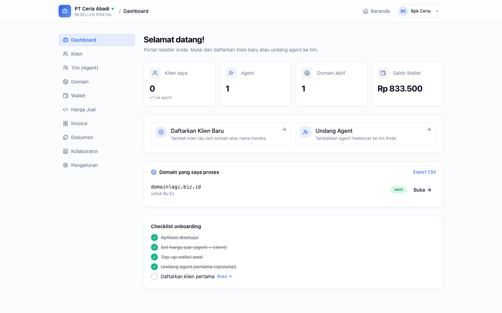
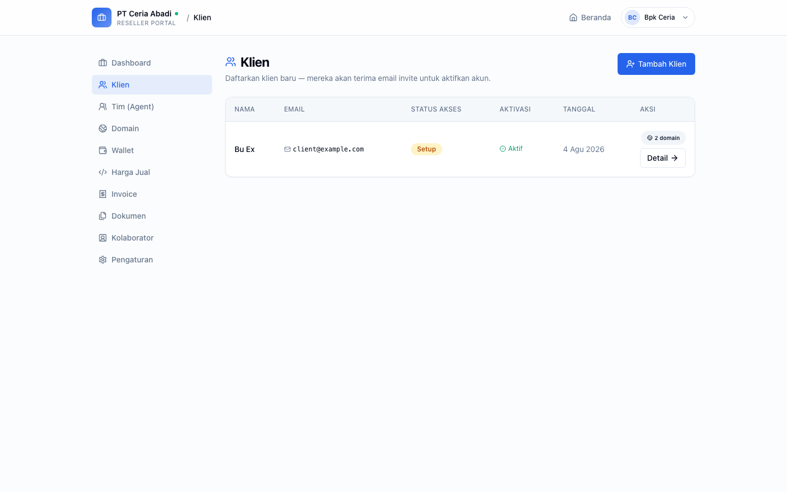
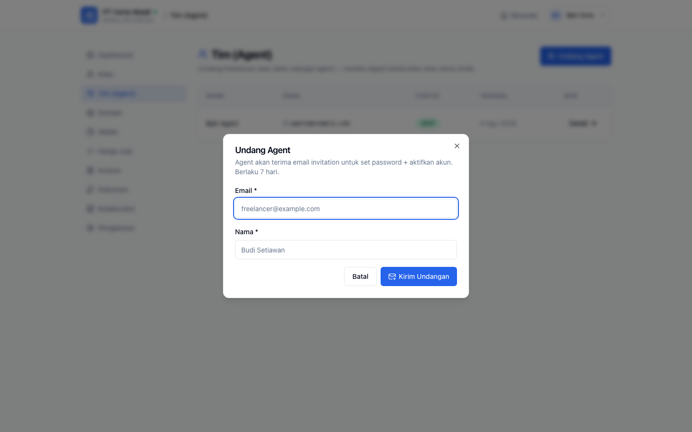
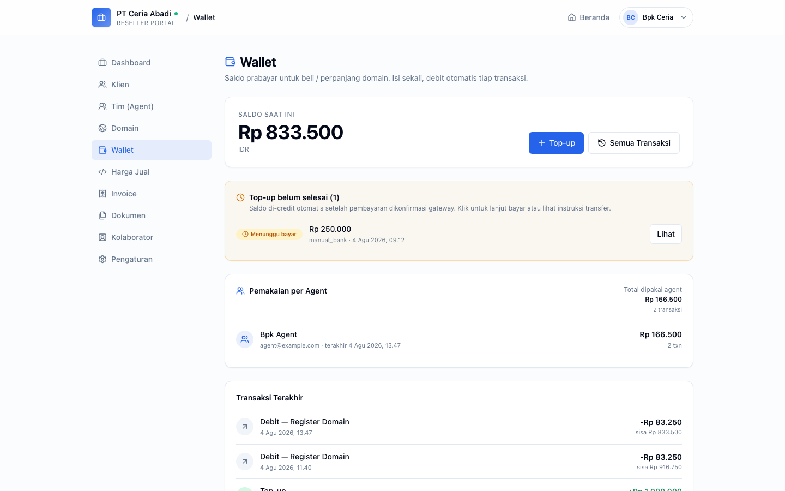
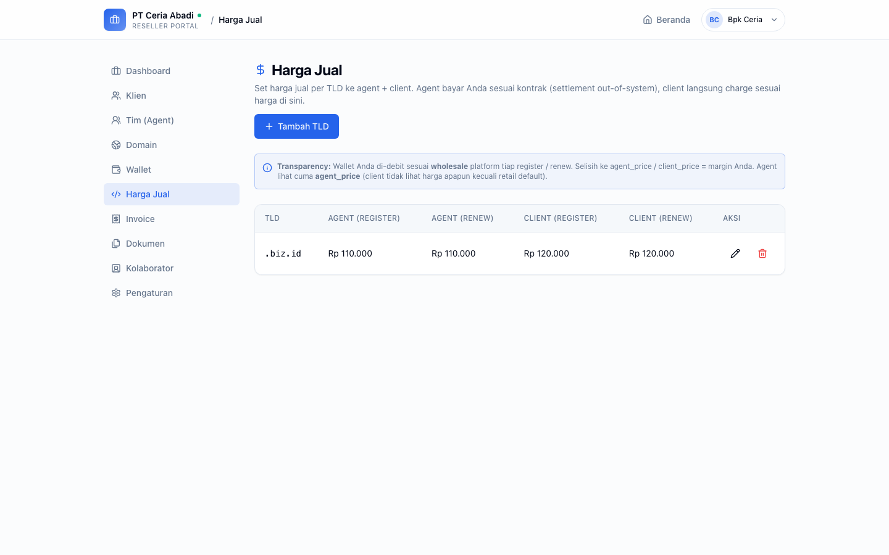

# Bab 3 — Panduan Reseller

Reseller adalah mitra bisnis yang jualan Web Builder ke pelanggan sendiri
dengan harga jual sendiri. Reseller punya wallet + tim Agent + list klien.

## 3.1 Daftar sebagai Reseller

Reseller **wajib approval Admin** — tidak bisa langsung aktif setelah daftar.

### Langkah Daftar

1. Buka `/reseller/apply` atau tombol "Daftar Reseller" di landing page
2. Isi:
   - **Email** + password
   - **Nama pribadi**
   - **Reseller display name** — nama bisnis (mis. "PT Web Solusi")
   - **Nomor telepon**
   - **Alamat perusahaan**
3. Submit → status **pending**
4. Tunggu Admin review — dapat email notifikasi kalau di-approve
5. Setelah approved, login → dashboard reseller aktif

## 3.2 Dashboard Reseller



### Struktur Bisnis Reseller

```
     ┌─────────────┐
     │   Anda      │  ◄── Reseller (approved by Admin)
     │  (Reseller) │
     └──────┬──────┘
            │
       ┌────┴─────┐
       │          │
       ▼          ▼
   ┌────────┐   ┌────────┐
   │ Agent  │   │ Client │  ◄── Direct client (Anda invite)
   │ (tim)  │   │        │
   └───┬────┘   └────────┘
       │
       │ manage
       ▼
   ┌────────┐
   │ Client │  ◄── Client via Agent (Agent invite)
   │        │
   └────────┘

  Wallet Anda ──► debit tiap transaksi (self OR via Agent)
```

`/reseller/dashboard`:

- **Card stats** — 4 tile: klien, agent, domain aktif, saldo wallet
- **Quick actions** — Daftarkan Klien Baru + Undang Agent
- **Domain yang diproses** — pending purchases untuk semua klien tim
- **Checklist onboarding** — 5 step untuk optimize akun:
  - Aplikasi disetujui ✓
  - Set harga jual
  - Top-up wallet awal
  - Undang agent pertama
  - Daftarkan klien pertama

## 3.3 Kelola Klien



Menu **Klien** — `/reseller/clients`.

### Tambah Klien Baru

Ada 2 cara:

**A. Invite via Email (recommended)**

1. Klik **+ Klien Baru**
2. Isi email + nama
3. Centang **Kirim invitation** → sistem email link ke klien
4. Klien klik link → set password sendiri → auto-login
5. Assignment otomatis di-create: Anda → klien

**B. Create Manual (klien tidak perlu login sendiri)**

Kalau Anda 100% take-over — misalnya klien tidak paham komputer:

1. **+ Klien Baru** → uncheck "Kirim invitation"
2. Set password sementara
3. Manual: share credential + login untuk klien saat perlu

Klien tetap bisa reset password sendiri via email nanti.

### List Klien

Kolom yang muncul:
- Nama, email, phone
- Managed by (kalau ada Agent yang assigned)
- Status (aktif, belum verify email, suspend)
- Total domain
- Tanggal join

Filter: role, status, agent (untuk cari klien yang di-manage agent tertentu).

### Assign Klien ke Agent

Kalau Anda punya Agent, bisa delegate klien ke mereka:

1. Klik klien → tab **Managed By**
2. **+ Assign Agent** — pilih dari list agent Anda
3. Set permission (editor / viewer / owner untuk situs)
4. Simpan

Agent langsung bisa manage klien itu (beli domain, edit situs).

### Revoke Assignment

Klik row assignment → **Revoke** — Agent lose access ke klien. Klien tetap
punya semua data-nya (domain, situs, dst.).

### Detail Klien

Klik row → `/reseller/clients/<id>`:

Tabs:
- **Profil** — full info klien
- **Domain** — list domain klien
- **Situs** — list situs klien + link editor (Anda otomatis editor)
- **Invoice** — riwayat transaksi klien
- **Aksi**:
  - **Beli Domain untuk klien**
  - **Edit profil klien**

## 3.4 Undang Agent



Menu **Tim** atau **Agent** — `/reseller/team` atau `/reseller/agents`.

### Kirim Invitation

1. Klik **+ Undang Agent**
2. Isi email + nama Agent
3. Klik **Kirim Undangan** → email dengan link accept dikirim
4. Agent klik link → set password → jadi Agent Anda

### List Agent

- Nama, email
- Status (aktif, pending accept)
- Jumlah klien yang di-manage
- Jumlah domain yang di-trigger
- Total revenue yang mereka drive

### Detail Agent

Klik row Agent → `/reseller/team/<agent_id>`:

- Info Agent
- Klien yang di-assign ke mereka
- Purchases mereka (semua transaksi + total)
- Aktivitas wallet (yang di-debit oleh mereka dari wallet Anda)

### Cabut Akses Agent

Klik row → **Suspend / Delete**:
- **Suspend**: Agent tidak bisa login, tapi data historis + assignment tetap
- **Delete**: hapus permanent, assignment ke klien juga di-clear

## 3.5 Wallet & Top-up



Menu **Wallet** — `/reseller/wallet`.

### Cek Saldo

Card besar di top: saldo current dalam Rupiah.

### Top-up Wallet

1. Klik **Top-up**
2. Isi nominal
3. Pilih metode:
   - **Midtrans / Paylabs** — instant charge via gateway
   - **Transfer Bank Manual** — transfer + upload bukti transfer
4. Kalau gateway: bayar → saldo masuk instant setelah webhook
5. Kalau manual: upload bukti → admin verify (1-24 jam) → saldo masuk

### Upload Bukti Transfer (Manual Bank)

Halaman top-up detail:
1. Klik row top-up dengan status **awaiting verification**
2. Klik **Upload Bukti**
3. Pilih file (JPG/PNG/PDF, max 8 MB)
4. Optional: tambah catatan
5. Submit → status jadi **awaiting_verification**, admin dapat notif
6. Setelah admin approve → saldo credit + ledger entry

### Ledger — Riwayat Transaksi

Tab **Ledger** di halaman Wallet:
- Semua credit + debit dengan timestamp
- Link ke invoice untuk debit (mis. domain register)
- Filter tanggal, tipe (credit/debit)

### Agents Breakdown

Tab **Per-Agent Activity**:
- Aggregate spending per Agent Anda dalam periode
- Cocok untuk track "Agent mana yang paling produktif" atau komisi kalkulasi
- Export ke CSV

## 3.6 Set Harga Jual (Pricing)



Ini yang bikin Reseller = bisnis. Anda set markup dari harga wholesale
platform.

### Konsep Harga

```
Harga Platform          Anda Set (per TLD)
──────────────          ──────────────────
Retail   Rp 250.000  ← baseline harga client
Wholesale Rp 180.000  ← Anda bayar segini per register

                     ─► Agent Price: Rp 200.000 (Anda tetapkan)
                        └─ Ini yang di-debit dari wallet saat Agent Anda beli
                     
                     ─► Client Price: Rp 240.000 (Anda tetapkan)
                        └─ Ini yang dilihat + dibayar client saat beli sendiri
```

**Margin Anda per transaksi**: `Wholesale − Client Price` untuk client
self-purchase, atau `Wholesale − Agent Price` kalau Agent beli untuk client.

### Set Harga per TLD

Menu **Harga Jual** — `/reseller/pricing`:

1. **+ TLD Baru** — pilih TLD dari list yang tersedia (di-whitelist platform admin)
2. Isi:
   - **Agent Register Price** — yang di-debit wallet Anda saat Agent register
   - **Agent Renew Price** — sama untuk renew
   - **Client Register Price** — yang dilihat client Anda
   - **Client Renew Price**
3. Simpan → harga langsung apply untuk transaksi berikutnya

### List Harga

Tab list menampilkan:
- Semua TLD yang sudah Anda set
- Kolom: agent_reg, agent_renew, client_reg, client_renew, wholesale (reference)

### Edit / Hapus

- **Edit**: klik row → panel edit → simpan
- **Hapus**: fallback ke retail platform (client bayar retail, wholesale tidak ada margin buat Anda)

## 3.7 Beli Domain untuk Klien (On-Behalf-Of)

Sama flow dengan Agent. Beda: transaksi di-log dengan `purchased_by = Anda`
(bukan `agent_id`), wallet yang dipotong = wallet Anda sendiri.

### Langkah

1. Menu Klien → pilih klien → **Beli Domain**
2. Wizard `/sites/new-with-domain?for_client=<uuid>`
3. Wizard tampilkan profil **klien** (bukan Anda)
4. Wizard tampilkan **wholesale price** yang di-debit + info margin Anda
5. Pilih metode: **Wallet** (instan, potong saldo Anda) atau gateway
6. Setelah domain active → pilih template → situs dibuat, owner = klien
7. Anda otomatis di-add sebagai editor

## 3.8 Purchases & Invoices Team

### Purchases

Menu **Purchases** — `/reseller/purchases`:

Semua transaksi yang trigger via tim Anda (self + Agent):
- Kolom: klien, domain, status, kind, total, tanggal
- Filter: status, kind, klien
- Export **CSV** — untuk akuntansi

### Invoices

Menu **Tagihan** — `/reseller/invoices`:

Aggregate list:
- Invoice self (top-up wallet Anda)
- Invoice klien (register + renew untuk mereka)
- Klik row → detail + PDF download

## 3.9 Statistik & Reporting

Menu **Statistik** — `/reseller/stats`:

- **Total klien** (direct + via agent)
- **Total agent** aktif
- **Total domain aktif** di tim
- **Total revenue** rolling 30 hari
- **Chart aktivitas** — line chart per bulan

## 3.10 Domain Klien (Aggregate)

Menu **Domain** — `/reseller/domains`:

Beda dari Purchases (yang transaction log), ini list **per FQDN unik**:
- 1 baris per domain
- Info: owner klien, status, expire, situs terkait, siapa yang trigger register

Filter berguna:
- `expires_at ≤ 30 hari` — domain yang mau expire, follow-up ke klien untuk renew

## 3.11 Kolaborasi Situs

Menu **Kolaborasi** — `/settings/collaborators`:

- **Situs saya** — situs milik Anda sendiri (kalau Anda punya)
- **Situs klien saya** — situs klien di mana Anda editor
- Klik row → buka editor

Reseller otomatis editor di semua situs klien yang Anda + Agent Anda buat.

## 3.12 Batasan Reseller

Yang TIDAK bisa Reseller lakukan:

- ❌ Approve reseller lain (itu admin only)
- ❌ Set harga di atas platform retail (ada guard di backend, mungkin)
- ❌ Reassign klien reseller lain ke Anda
- ❌ Akses `/admin/*` (akses admin platform)

## 3.13 Best Practice

**1. Set harga jual DULU sebelum invite Agent**

Kalau Agent Anda beli domain sebelum Anda set harga TLD tersebut, sistem
fallback ke retail platform — Anda tidak dapat margin.

**2. Top-up wallet cukup**

Kalau saldo habis di tengah transaksi Agent, mereka blocked. Kalau bisnis
aktif, top-up 2x lipat rata-rata transaksi bulanan supaya tidak sering
top-up.

**3. Monitor Agent Breakdown**

Cek berkala menu Wallet → Agents Breakdown untuk deteksi:
- Agent yang tidak aktif (0 transaksi) — mungkin butuh training
- Agent yang salah beli (mis. domain expensive tanpa persetujuan)
- Untuk hitung komisi

**4. Test flow sebagai Client dulu**

Sebelum onboard klien beneran, coba self-purchase dari akun test → alami
sendiri flow-nya → bisa jelaskan ke klien saat mereka bingung.

## 3.14 Troubleshoot

**Aplikasi reseller saya masih pending 2 hari**
- Hubungi admin — biasanya approve 1x24 jam kerja

**Agent invitation email tidak terkirim ke Agent**
- Cek Spam folder Agent
- Cek Anda tidak salah tulis email di form invite
- Re-send: klik row Agent (status pending) → **Kirim Ulang**

**Wallet debit tidak sesuai — Agent beli tapi saldo saya tidak turun**
- Kemungkinan transaksi di-cancel / failed di provisioning stage — wallet
  auto-refund
- Cek ledger, kalau ada baris "refund", itu sudah dikembalikan

**Klien tidak bisa akses situs setelah saya belikan**
- Cek domain status: sudah active?
- Cek Cloudflare attach: sudah success? (info di `/settings/domains/<domain>`
  tab Cloudflare)
- Kalau CF attach failed, ada tombol Retry di admin — hubungi admin

**Set harga tapi client masih lihat harga retail**
- Cek TLD yang Anda set match dengan TLD yang client cari — mis. set `id`
  tapi client cari `co.id` = beda TLD
- Refresh cache: logout-login client lagi (kadang wizard cache pricing)

**Berapa margin saya per domain?**
- Buka `/reseller/pricing` — kolom margin visible sebagai `client_price − wholesale`
  untuk client self, atau `agent_price − wholesale` untuk transaksi via Agent
