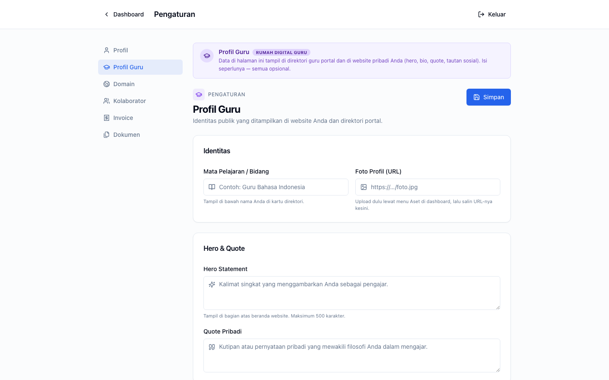
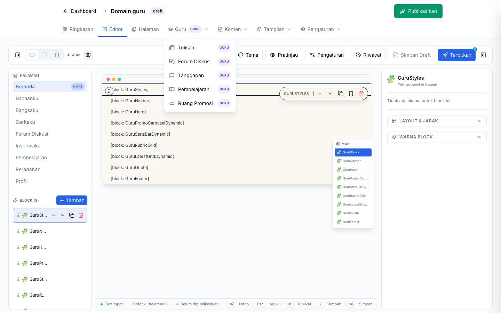
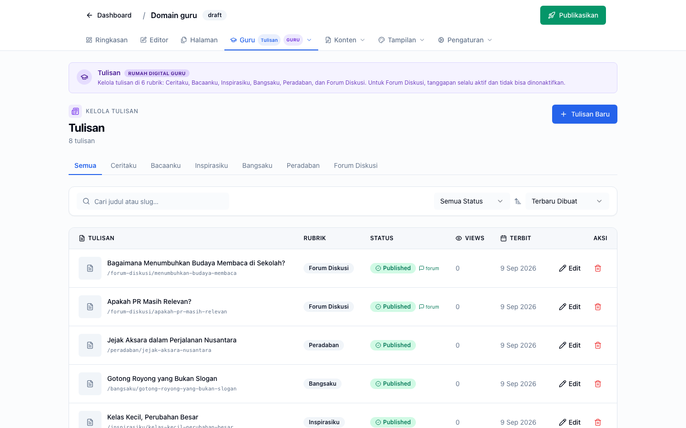
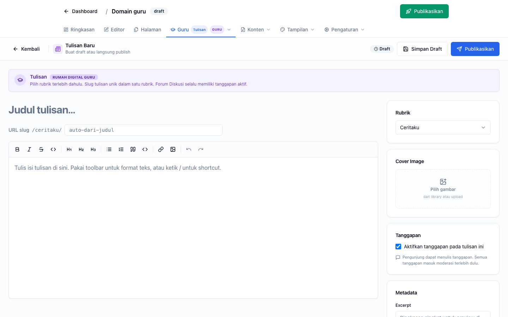
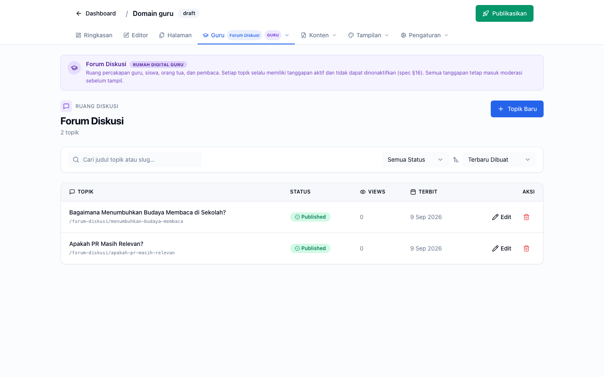
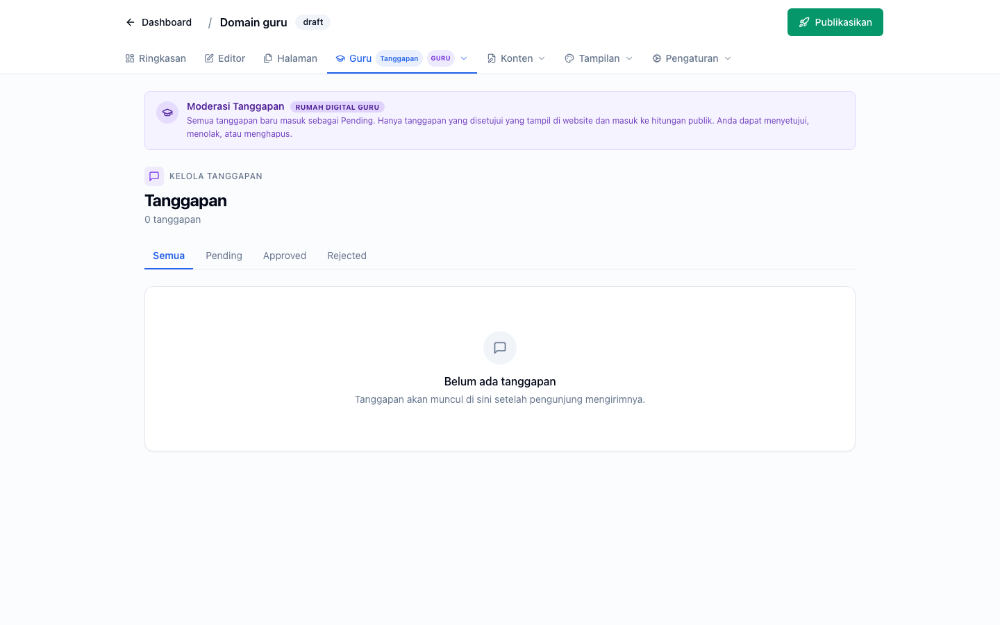
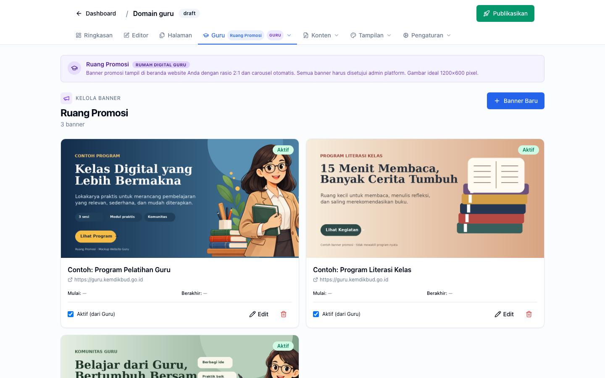
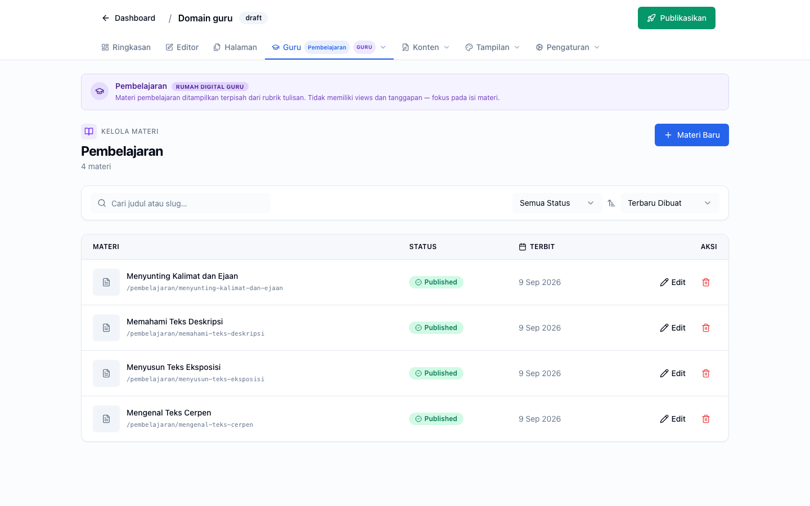
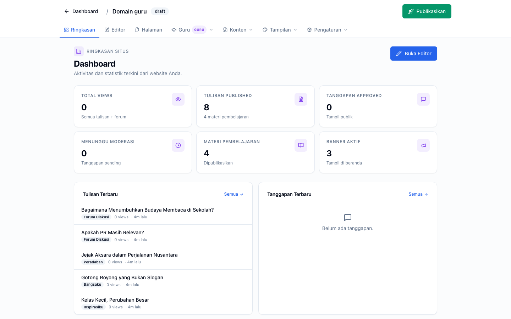
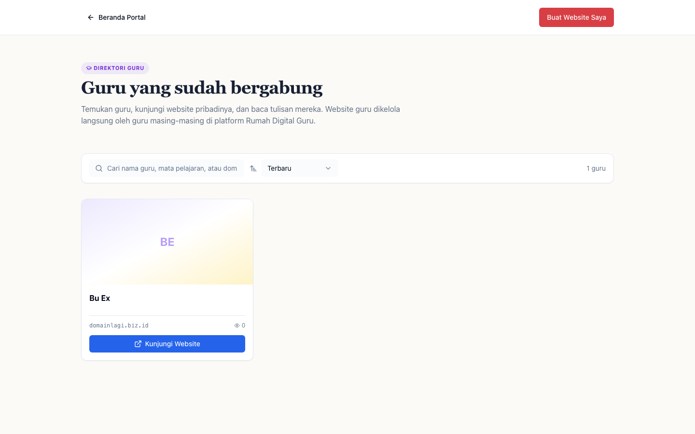

# Panduan Guru — Rumah Digital Guru

Bab ini panduan lengkap untuk **Guru** yang menggunakan template **Rumah
Digital Guru** (Guru PANDI × UPI). Fitur ini opsional — semua situs client
bisa pakai fitur di sini, tapi tampilannya paling sesuai kalau situs
dibangun dari template guru.

## Apa itu Rumah Digital Guru?

Program kolaborasi PANDI × UPI untuk memberi guru Indonesia **website
pribadi** yang menjadi rumah digital pribadi — bukan sekadar profil di
platform milik orang lain. Konsep:

- **Website .id** — alamat pribadi yang mewakili diri guru
- **Enam Ruang Utama** untuk berbagi pengetahuan (Ceritaku, Bacaanku,
  Inspirasiku, Bangsaku, Peradaban, Forum Diskusi)
- **Pembelajaran** — materi ajar terpisah
- **Ruang Promosi** — banner program pelatihan / literasi / komunitas
- **Direktori Portal** — kartu guru tampil di portal publik `/guru`

Referensi lengkap spesifikasi produk: [Spesifikasi Developer Portal &
Website Guru Final](../../Spesifikasi-Developer-Portal-dan-Website-Guru-Final.md).

## Cara Memulai

### 1. Buat Website dengan Template Guru

1. Login sebagai Client
2. Klik **"Beli Domain + Buat Situs"** di dashboard
3. Cari + beli domain (`.id` disarankan untuk guru Indonesia)
4. Setelah domain aktif, pilih template **Guru PANDI × UPI**
5. Website otomatis ter-provisioning dengan:
   - 9 halaman (Beranda, Profil, 5 rubrik, Forum Diskusi, Pembelajaran)
   - **8 sample tulisan** — biar website tidak kosong sejak awal
   - **4 sample materi pembelajaran**
   - **3 sample banner promosi**

Sample data ini boleh Anda hapus / edit — anggap sebagai starter.

### 2. Isi Profil Guru

Sebelum menulis, isi profil terlebih dahulu supaya kartu guru di direktori
portal terlihat lengkap. Buka **Pengaturan → Profil Guru**:

- **Mata Pelajaran / Bidang** — muncul di bawah nama Anda di kartu
- **Foto Profil** — URL gambar (upload dulu di menu Aset, salin URL)
- **Hero Statement** — kalimat 1-2 baris di beranda website
- **Quote Pribadi** — filosofi mengajar / motto
- **Bio Singkat** — max 280 karakter, tampil di kartu preview
- **Bio Lengkap** — max 4000 karakter, tampil di halaman Profil
- **Tautan Sosial** — twitter, instagram, youtube, dll. (max 10)

> ⚠️ Foto profil belum bisa upload dari halaman ini — upload dulu via menu
> **Aset** di dashboard situs, lalu salin URL-nya.

## Menu Guru di Dashboard Situs

Buka situs guru di dashboard, lalu perhatikan sidebar. Di grup **Guru
▾** (dropdown ungu, dengan pill "GURU") ada 5 menu:

| Menu | Fungsi |
|---|---|
| **Tulisan** | 6 rubrik: Ceritaku, Bacaanku, Inspirasiku, Bangsaku, Peradaban, Forum Diskusi |
| **Forum Diskusi** | Sub-menu khusus untuk topik diskusi (tanggapan wajib aktif) |
| **Tanggapan** | Moderasi komentar pengunjung (approve/reject/hapus) |
| **Pembelajaran** | Materi belajar terpisah (tanpa tanggapan, tanpa views) |
| **Ruang Promosi** | Banner promo di beranda website + agregat portal |

## Kelola Tulisan (6 Rubrik)

### Rubrik yang tersedia

1. **Ceritaku** — cerita pengalaman mengajar sehari-hari
2. **Bacaanku** — ulasan buku yang Anda baca
3. **Inspirasiku** — praktik baik, ide, orang yang menginspirasi
4. **Bangsaku** — kewargaan, keberagaman, bahasa Indonesia
5. **Peradaban** — sejarah, budaya, warisan Nusantara
6. **Forum Diskusi** — topik untuk diskusi terbuka

### Buat tulisan baru

1. Menu **Guru → Tulisan** → klik **"Tulisan Baru"**
2. Pilih **rubrik** (locked setelah simpan pertama — tidak bisa pindah rubrik)
3. Isi:
   - **Judul** (wajib)
   - **URL slug** — auto-generate dari judul, boleh edit
   - **Cover image** (opsional)
   - **Excerpt** — ringkasan untuk kartu list
   - **Isi tulisan** — pakai rich editor (bold/italic/heading/list/link)
   - **Tags** — pisah dengan koma
   - **Reading time** — estimasi dalam menit (0 = disembunyikan)
4. **Toggle "Aktifkan tanggapan"** — spec §15
   - **ON**: pengunjung bisa kirim komentar (masuk moderasi)
   - **OFF**: form + jumlah tanggapan disembunyikan dari publik
   - **Forum Diskusi**: toggle di-force ON, tidak bisa di-nonaktifkan (spec §16)
5. Klik **"Simpan Draft"** atau **"Publikasikan"**

### Aturan slug

Slug harus unik dalam satu rubrik. Contoh:
- `/ceritaku/hari-pertama-ngajar` ✅
- `/bacaanku/hari-pertama-ngajar` ✅ (rubrik beda)
- 2× `/ceritaku/hari-pertama-ngajar` ❌ (duplikat, ditolak backend)

## Forum Diskusi (Menu Terpisah)

Sub-menu **Forum Diskusi** adalah alias untuk rubric `forum-diskusi` dengan
UX berbeda dari tulisan biasa:

- CTA berbunyi **"Topik Baru"** (bukan "Tulisan Baru")
- Tanggapan **wajib aktif**, toggle disabled di form
- Info banner mengingatkan aturan spec §16
- Cocok untuk memulai percakapan dengan pembaca

Topik forum akan tampil di halaman `/forum-diskusi` website Anda dan di
block Forum di beranda template.

## Moderasi Tanggapan

Semua tanggapan baru masuk sebagai **Pending** (spec §18). Hanya tanggapan
yang **Approved** yang tampil publik dan dihitung ke total.

### Alur moderasi

1. Menu **Guru → Tanggapan**
2. Tab filter: **Semua / Pending / Approved / Rejected**
3. Per tanggapan Anda bisa:
   - **Setujui** — status → approved, tampil publik
   - **Tolak** — status → rejected, tidak tampil (bisa di-approve lagi nanti)
   - **Hapus** — permanen (row dihapus dari DB)

> 💡 **Tip**: cek dashboard ringkasan setiap hari — stat card "Menunggu
> Moderasi" akan warna kuning kalau ada backlog.

### Form pengunjung

Pengunjung mengisi 3 field:
- **Nama** (wajib, max 60 char)
- **Peran**: Guru / Siswa / Orang Tua / Pembaca
- **Isi tanggapan** (wajib, max 2000 char)

Email di-collect internal untuk anti-spam, tapi **tidak** ditampilkan di publik.

### Anti-spam

Form dilengkapi honeypot — field tersembunyi yang bot cenderung isi.
Kalau ke-fill, submit di-drop tanpa notice ke bot (spec §40). Rate limit
per IP juga aktif untuk cegah flood.

## Ruang Promosi (Banner)

Banner promo tampil di **beranda website Anda** (langsung di bawah hero)
dan bisa juga tampil di **carousel portal publik** kalau Admin platform
mengizinkan.

### Buat banner

1. Menu **Guru → Ruang Promosi** → klik **"Banner Baru"**
2. Isi:
   - **Judul Internal** — untuk memudahkan Anda kelola (tidak tampil publik)
   - **Gambar** — rasio **2:1** (contoh 1200×600 pixel)
   - **URL Tujuan** — http/https (external OK)
   - **Alt Text** — deskripsi gambar untuk aksesibilitas (wajib)
   - **Urutan** — angka kecil tampil dulu
   - **Aktif** — checkbox teacher_active
   - **Periode** — start_at / end_at opsional (kosong = selalu tampil)
3. Simpan

### Status banner

Setiap banner punya 3 lapis status:

| Status Efektif | Arti |
|---|---|
| **Aktif** | Tampil di beranda + portal |
| **Nonaktif oleh Guru** | Anda uncheck "Aktif" |
| **Dinonaktifkan oleh Admin** | Admin platform override — Anda tidak bisa force tampil |
| **Belum Mulai** | `start_at` di masa depan |
| **Berakhir** | `end_at` sudah lewat |

> ⚠️ Kalau banner Anda **Dinonaktifkan oleh Admin**, alasan akan tampil
> merah di kartu. Baca alasannya sebelum edit/upload ulang.

## Pembelajaran (Materi)

Materi pembelajaran adalah tipe konten **terpisah** dari tulisan:

- **Tidak ada tanggapan** — pengunjung tidak bisa komentar
- **Tidak ada views** — tidak masuk statistik total views situs
- Fokus pada **isi materi** + **ringkasan**

### Buat materi

1. Menu **Guru → Pembelajaran** → **"Materi Baru"**
2. Isi:
   - Judul, slug, cover image
   - **Deskripsi Singkat** — ringkasan untuk kartu list
   - **Isi Materi** — full content
   - **Ringkasan Materi** — box khusus di bawah body (opsional)
   - **Kata Kunci** — tags
3. Publikasikan

Materi tampil di halaman `/pembelajaran/{slug}` website Anda.

## Dashboard Ringkasan

Halaman utama situs (klik nama situs di dashboard) menampilkan **6 stat
card** (spec §21):

- **Total Views** — semua artikel + forum
- **Tulisan Published** — jumlah artikel yang published (semua rubrik)
- **Tanggapan Approved** — yang tampil publik
- **Menunggu Moderasi** — tanggapan pending (warna kuning kalau > 0)
- **Materi Pembelajaran** — jumlah materi published
- **Banner Aktif** — banner yang effective_status = "active"

Di bawahnya ada 2 list:
- **Tulisan Terbaru** — 5 artikel published terakhir
- **Tanggapan Terbaru** — 5 tanggapan terbaru (mix status)

Klik card / row untuk drill-down ke menu yang relevan.

## Portal Direktori Guru (`/guru`)

Website Anda otomatis muncul di **direktori guru publik** di URL
`https://<domain-platform>/guru` (spec §5) — asal:

- Status situs Anda `published`
- Situs punya minimal 1 domain aktif ter-attach

Kartu Anda menampilkan:
- Nama guru + mata pelajaran (dari Profil Guru)
- Foto profil (kalau ada) atau initial
- Domain website
- Total views semua tulisan
- Badge "Baru" kalau situs < 14 hari
- Tombol **"Kunjungi Website"**

Sort default: **Terbaru**. Pengunjung bisa switch ke **Terpopuler** (by
total views).

## Sitemap Otomatis

Sitemap `sitemap.xml` di setiap website guru sudah otomatis include:
- Halaman utama + sub-page
- Semua artikel `/{rubric}/{slug}` (per 6 rubric, max 100/rubric)
- Semua materi `/pembelajaran/{slug}` (max 200)
- Blog post + produk (kalau ada)

Ini penting untuk **SEO** — Google akan tahu semua konten Anda.

## Tips & Best Practice

### Untuk Guru Baru

1. **Isi Profil Guru dulu** sebelum publish tulisan pertama — supaya
   kartu direktori tidak kosong
2. **Ganti sample data** — 8 sample tulisan + 4 materi yang di-generate
   template hanya starter. Edit atau hapus supaya website terasa milik Anda
3. **Mulai dari Ceritaku** — rubric paling ringan, cocok latihan menulis
4. **Aktifkan tanggapan** di 1-2 tulisan pertama — biar pembaca terlibat

### Untuk Guru Aktif

1. **Cek dashboard tiap pagi** — moderasi backlog tanggapan
2. **Update banner** sesuai program yang sedang berjalan
3. **Publikasi konsisten** — algoritma sort "Terbaru" di direktori favor
   situs yang aktif
4. **Isi tag** di setiap tulisan — bantu pembaca menjelajah topik

## FAQ

**Q: Apa bedanya Tulisan dan Blog?**
A: Tulisan (menu Guru) khusus 6 rubrik guru dengan moderasi tanggapan
per-tulisan. Blog (menu Konten) generic untuk artikel biasa tanpa rubric.
Untuk template guru, gunakan **Tulisan**.

**Q: Bisa disable tanggapan di Forum Diskusi?**
A: Tidak. Spec §16 forum wajib punya tanggapan aktif — kalau tidak, itu
bukan forum. Kalau tidak butuh diskusi, pakai rubric lain.

**Q: Banner saya di-nonaktifkan Admin, apa yang harus dilakukan?**
A: Baca alasan yang tampil di kartu banner (merah). Perbaiki sesuai
alasan (misal ganti gambar yang tidak sesuai pedoman), lalu kontak admin
platform untuk re-review.

**Q: Views tidak bertambah walau tulisan sudah publish?**
A: View counter naik saat pengunjung buka halaman detail. Ada dedupe
per-IP 60 menit — refresh cepat dari IP yang sama hanya dihitung 1x.
Views merefleksikan pembaca unik, bukan click count.

**Q: Sample data template bisa di-restore setelah dihapus?**
A: Tidak otomatis. Data sample di-seed sekali saat site pertama dibuat.
Anda perlu buat manual kalau ingin balik.

**Q: Kolaborator bisa moderasi tanggapan saya?**
A: Ya. Semua site member (owner + editor) bisa akses menu Tanggapan.
Owner-only checks hanya untuk hapus site + transfer domain.
