# Panduan Klien — Rumah Digital Guru

Panduan lengkap untuk **guru** yang membangun website pribadinya dengan
Web Builder + template Rumah Digital Guru (PANDI × UPI). Alur end-to-end
dari daftar akun hingga publikasi konten.

Bab ini menggantikan alur klien lama untuk fitur guru terbaru (Q1 2026):
shared layout header/footer, editor micro-editing, autosave rich editor,
drag-drop image, dan penanganan media yang lebih ramah pemula.

> 📸 **Catatan screenshot**: sebagian screenshot fitur editor baru (Layout
> Bersama, micro-editing, autosave badge) mungkin **belum ter-capture di
> bundle PDF** karena UI berubah pesat di Q1 2026. Jalankan
> `node capture.mjs client` di `docs/user-guide/capture-screenshots/`
> untuk regenerate — atau ikuti tampilan di UI Anda langsung (langkah + alur
> tetap sama seperti dijelaskan).

---

## 1. Daftar Akun

Kalau belum punya akun, buka halaman `/register` di dashboard Web Builder
(mis. `https://bikinweb.pandi.id/register`).

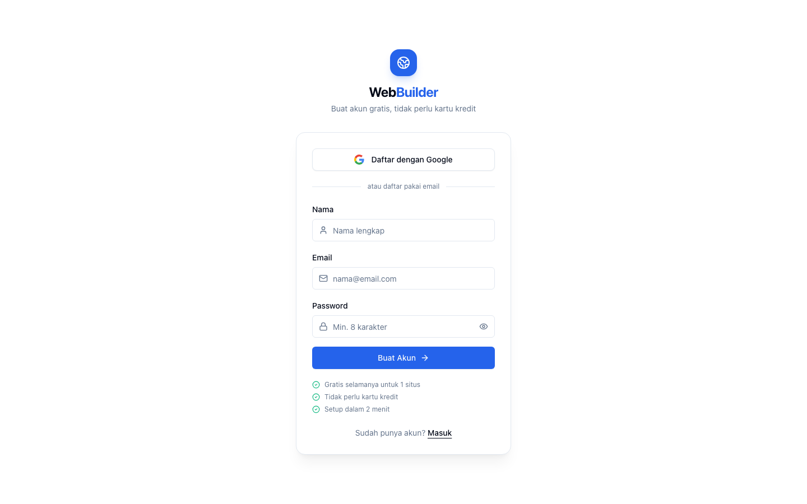

Isi:
- **Nama** — nama lengkap Anda (tampil di kartu direktori guru nanti)
- **Email** — untuk login + notifikasi transaksi + expiry domain
- **Password** — minimal 8 karakter, kombinasi huruf + angka
- **Konfirmasi Password**

Klik **Daftar**. Sistem otomatis login setelah pendaftaran sukses → langsung
diarahkan ke **Dashboard**.

> **Catatan**: role default adalah `client`. Tidak perlu izin admin — semua
> guru bisa mulai sendiri.

---

## 2. Login

Untuk login berikutnya, buka `/login`.

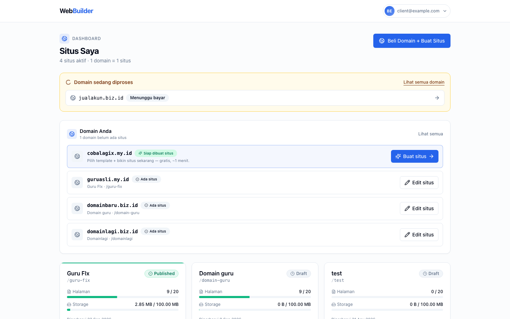

Tips:
- Password lupa? Ketuk tautan **Lupa Password** — kode reset dikirim ke email
  (butuh 1-3 menit, cek folder Spam kalau tidak masuk)
- Token akses berlaku 15 menit, otomatis diperpanjang selama tab aktif —
  Anda hampir tidak akan pernah "diusir keluar" secara tiba-tiba

---

## 3. Beli Domain (Wajib untuk Buat Situs)

Web Builder menerapkan konsep **1 domain = 1 situs**. Tidak ada subdomain
gratis — setiap situs baru membutuhkan domain yang sudah dibeli lewat
platform ini.

### 3.1. Buka Wizard "Beli Domain + Buat Situs"

Dari dashboard, ketuk tombol **Beli Domain + Buat Situs** (CTA utama di
tengah). Wizard akan memandu 3 langkah.

### 3.2. Cari Domain

Ketik nama yang Anda inginkan di kolom pencarian (mis. `rumahsayaguru`).
Wizard cek ketersediaan real-time di semua TLD (`.id`, `.com`, `.web.id`,
`.sch.id`, dst).

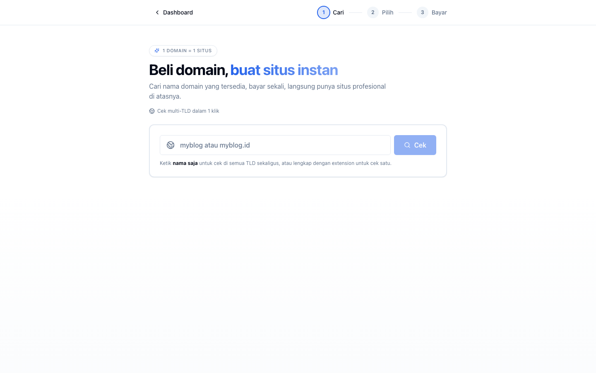

**Rekomendasi untuk guru Indonesia**: `.id` — mencerminkan identitas
nasional + support penuh dari PANDI. TLD `.sch.id` untuk sekolah, `.or.id`
untuk komunitas guru.

### 3.3. Konfirmasi + Isi Data Kontak

Setelah pilih TLD:
- Wizard menampilkan **subtotal + PPN 11%**
- Isi **profil pemilik domain** (nama, HP, alamat, kota, kode pos)
- Untuk `.id`: **NIK** wajib (validasi ke Dukcapil oleh registry)
- Punya **kode promo**? Ketuk "Punya kode promo?" → validasi otomatis, diskon
  langsung tercermin di total

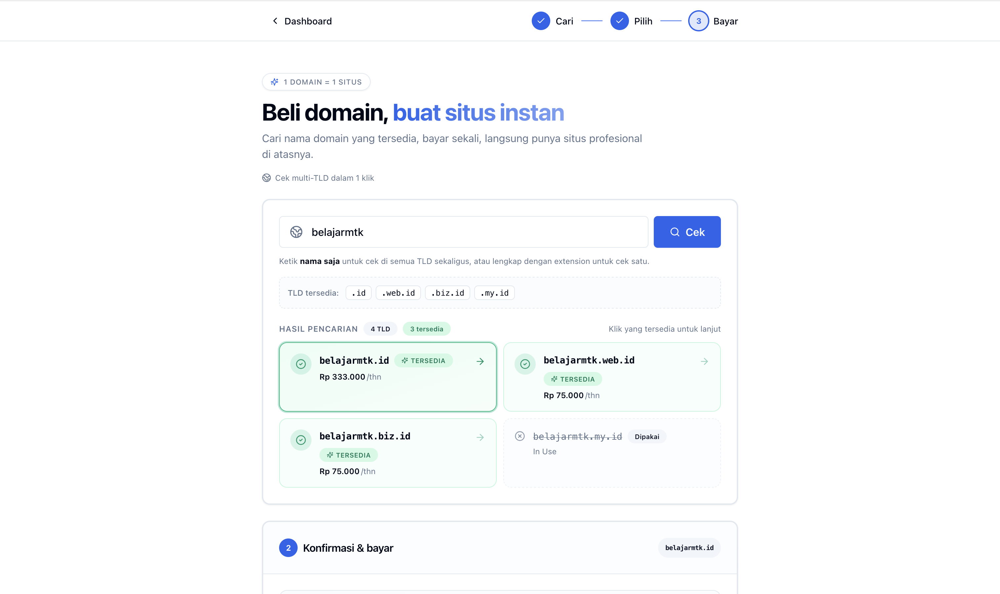

### 3.4. Pilih Metode Pembayaran

- **Midtrans / Paylabs** — transfer bank virtual account, kartu kredit,
  e-wallet (GoPay, OVO, Dana)
- **Transfer Bank Manual** — bukti transfer di-verifikasi admin (1-2 jam
  jam kerja)

Ketuk **Bayar Sekarang** → arahkan ke halaman pembayaran gateway.

### 3.5. Menunggu Domain Aktif

Setelah pembayaran sukses, wizard arahkan ke **halaman polling status**.
Timeline biasanya:

1. `pending_payment` → biru — menunggu konfirmasi pembayaran
2. `pending_provisioning` → kuning — sudah bayar, sedang di-register ke
   registry (10 detik–2 menit tergantung TLD)
3. `active` → hijau — domain resmi milik Anda

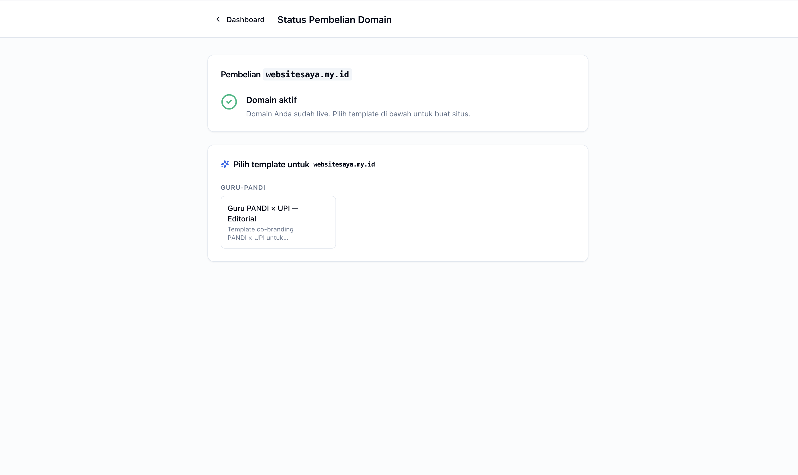

Halaman auto-refresh tiap 3 detik. Kalau `failed`, muncul tombol **Coba
Lagi** — retry tidak dikenakan biaya ulang.

---

## 4. Pilih Template Rumah Digital Guru

Setelah domain `active`, tombol **Pilih Template** muncul otomatis. Wizard
menampilkan daftar template — cari **Guru PANDI × UPI**.

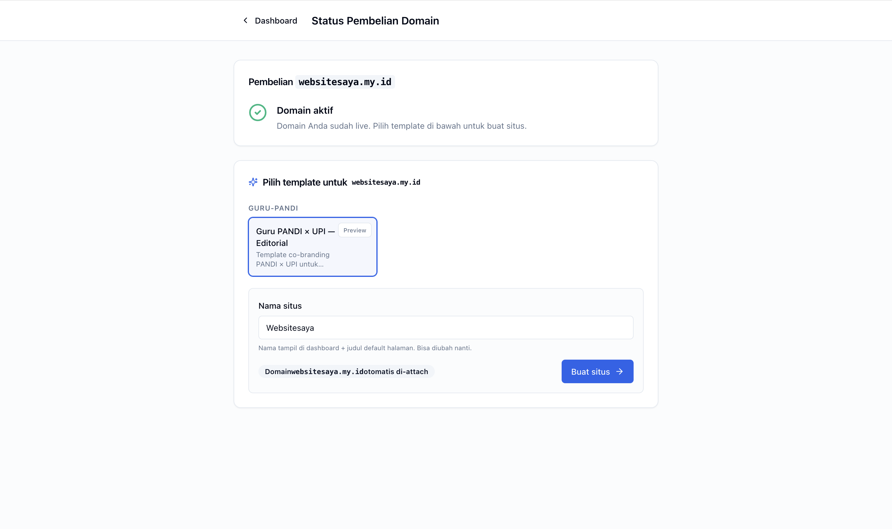

Ketuk kartunya → **Gunakan Template**. Sistem otomatis membangun:

- **9 halaman**: Beranda, Profil, 5 rubrik (Ceritaku / Bacaanku / Inspirasiku
  / Bangsaku / Peradaban), Forum Diskusi, Pembelajaran
- **8 tulisan contoh** dari 5 rubrik
- **4 materi pembelajaran contoh**
- **3 banner promosi contoh**
- **Layout Bersama** — Header (Guru Navbar) + Footer (Guru Footer) di-set
  otomatis dari template, aktif di semua halaman
- **Profil default** — subject "Guru Bahasa Indonesia", hero statement,
  quote (hanya diisi kalau profil Anda masih kosong — tidak menimpa edit
  yang sudah ada)

Sample data boleh Anda hapus / edit — anggap sebagai starter.

> ⏱️ Provisioning selesai dalam ~5 detik. Setelah itu Anda otomatis
> diarahkan ke editor situs baru.

---

## 5. Dashboard Situs

URL: `/sites/[id]` — tampilan awal setelah masuk situs Anda. Sidebar kiri
gelap (navy) menampilkan semua fitur situs.

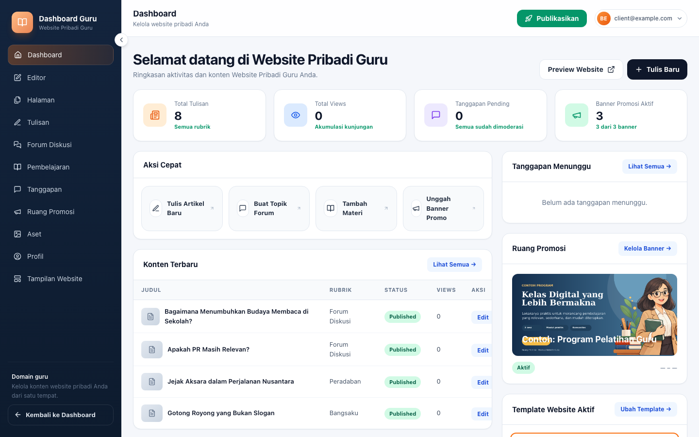

Menu sidebar (dari atas):

| Menu | Fungsi |
|---|---|
| **Dashboard** | Overview stat views/tanggapan/tulisan/materi + shortcut |
| **Editor** | Editor blok visual — susun halaman dengan drag-drop + inline edit |
| **Halaman** | Daftar halaman situs, tambah/hapus/duplikat |
| **Tulisan** | Kelola artikel 6 rubrik + forum diskusi |
| **Forum Diskusi** | Shortcut ke Tulisan filter rubrik `forum-diskusi` |
| **Pembelajaran** | Kelola materi pembelajaran (untuk siswa/pembaca) |
| **Tanggapan** | Moderasi komentar pembaca |
| **Ruang Promosi** | Banner 2:1 untuk program guru |
| **Aset** | Upload + kelola gambar & audio |
| **Profil** | Identitas guru + hero statement + bio + tautan sosial |
| **Tampilan Website** | Ganti template, kustomisasi warna & font |

Tombol **Publikasikan** di header kanan atas → publish semua halaman
sekaligus (dari status draft ke live).

---

## 6. Editor Blok — Susun Halaman Visual

URL: `/sites/[id]/editor`. Editor 3-kolom:

- **Kiri**: navigasi (Layout Bersama · Halaman · Blok tree)
- **Tengah**: canvas preview (device: desktop / tablet / mobile)
- **Kanan**: properti blok yang sedang dipilih

### 6.1. Overview Layout Editor

### 6.2. Layout Bersama (Header & Footer)

Fitur **baru**: header dan footer dikelola sekali → berlaku ke **semua
halaman**. Di sidebar kiri paling atas ada seksi **Layout Bersama** dengan
2 entri: **Header** dan **Footer**.

Ketuk **Header** → canvas berpindah ke mode edit header. Muncul strip
amber di atas canvas dengan toggle **"Header aktif"**.

- **Toggle aktif ON** (default) — header render di semua halaman
- **Toggle OFF** — header sembunyi di semua halaman (blok tetap tersimpan,
  bisa diaktifkan lagi kapan saja)

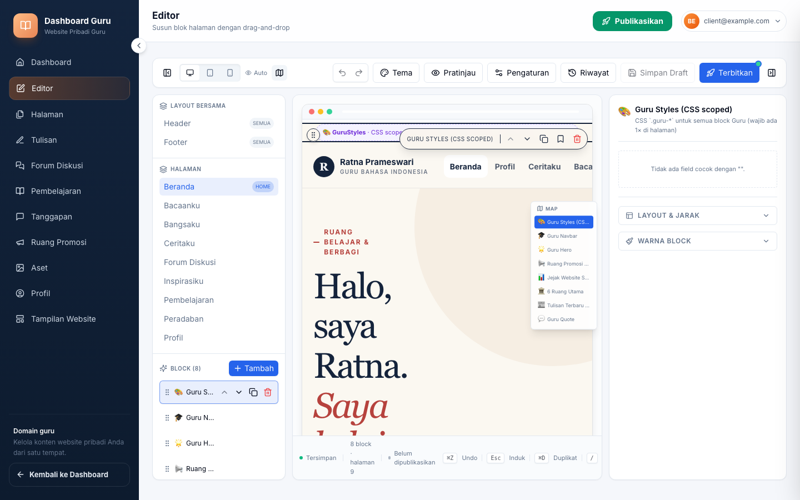

**Kenapa penting?**
- Edit sekali (mis. ganti tautan menu, ubah nama guru di brand) → otomatis
  update di ~10 halaman
- Kalau ingin halaman khusus tanpa header (mis. landing kampanye), matikan
  toggle sementara

Saat mode **halaman biasa**, guru akan melihat **preview read-only** dari
header di atas canvas + footer di bawah — cukup tampilkan visual, klik
untuk masuk mode edit layout. Blok Navbar/Footer di dalam page tree
otomatis di-sembunyikan supaya tidak double render.

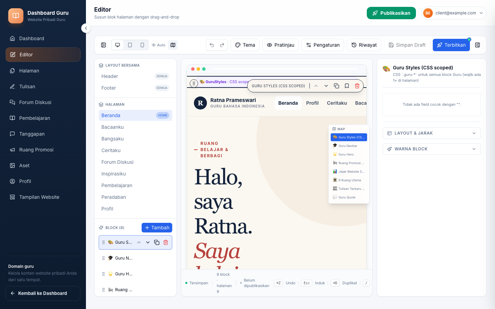

### 6.3. Micro-Editing Inline

Fitur **baru**: semua text di blok bisa di-edit **langsung di canvas**
(bukan cuma via panel kanan). Klik pada judul hero, subtitle, label tombol,
item counter — cursor langsung masuk mode edit. Blur (klik di luar) atau
tekan Enter → simpan.

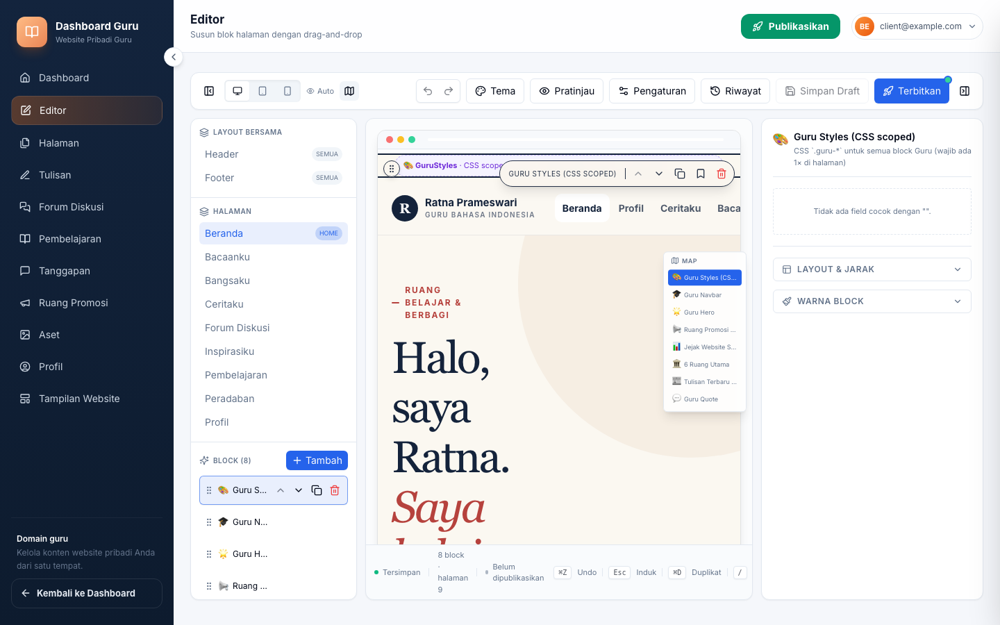

Berlaku untuk semua blok Guru (Navbar, Hero, Footer, Rubric Grid, Rubric
Hero, Quote, Profile Card, Timeline, Tag List, Stats Bar, Latest Grid,
Article Grid, Learning Grid) dan blok Pro (Aurora Hero, Highlight Hero,
Typewriter Hero, Glow Card Grid, Border Beam Card, Card Stack Showcase,
Animated Counter Stats, Moving Border CTA, dll).

**Yang masih via panel kanan**: URL link, URL gambar, tambah/hapus item
dari list, warna, spacing — karena butuh picker khusus.

### 6.4. Drag-Drop Blok + Ghost Preview

Setiap blok punya **handle drag** (ikon `≡` di corner) — geser untuk ubah
urutan. Selama drag, muncul **badge ghost** kecil (emoji + nama blok) yang
mengikuti cursor → tahu blok mana yang sedang dipindah.

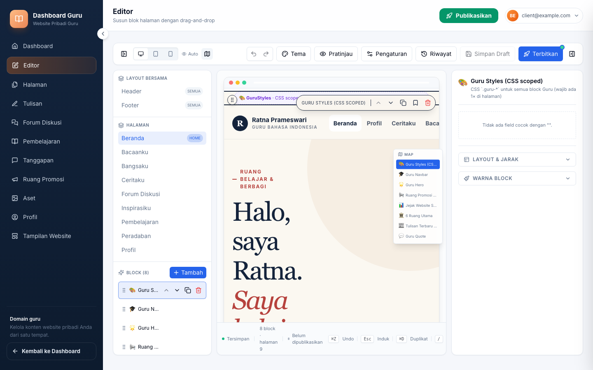

**Drag ke Container / Columns**: kalau halaman punya blok Container atau
Columns, Anda bisa drop blok **ke dalamnya** — container kosong menampilkan
"Container kosong · lepas block di sini" sebagai target drop.

### 6.5. Tambah Blok Baru

Ketuk **+ Tambah** di sidebar kiri atau tombol besar di canvas kosong →
dialog palette. Filter dengan search atau tab (Semua / Pro / Standar /
Snippet). Klik blok → langsung tersisip di posisi terakhir.

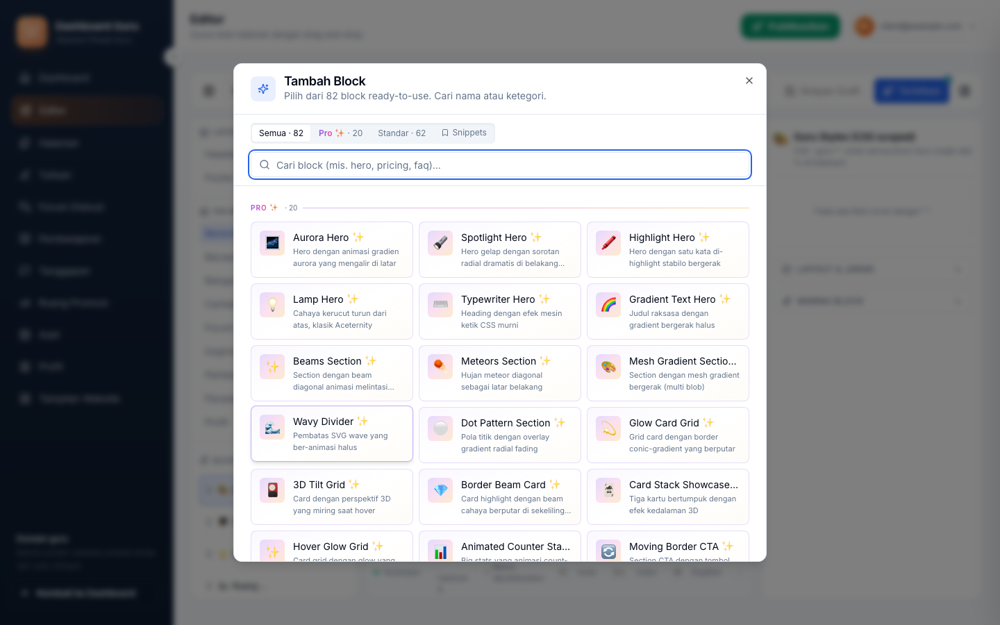

### 6.6. Panel Layout & Style

Blok yang di-select → panel kanan menampilkan **Konten** (schema field)
dan **Layout & Style** (padding, margin, max-width, alignment, background,
override warna). Semua responsive-aware — bisa set beda per breakpoint
(mobile / tablet / desktop).

### 6.7. Ganti Tema

Ketuk ikon **Tema** di toolbar → drawer warna + font. Semua blok otomatis
pakai variable CSS `--color-primary`, `--font-heading`, dst → ganti warna
= ganti seluruh situs.

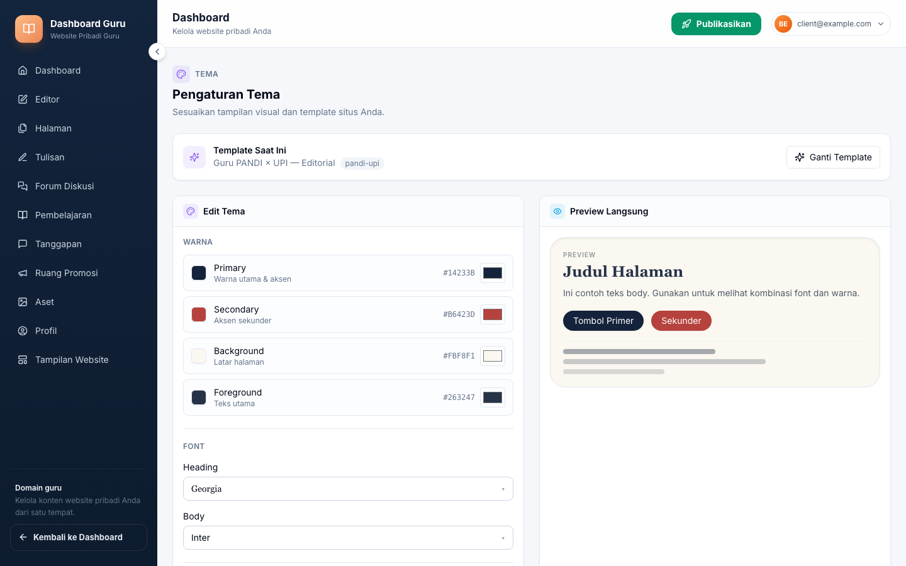

---

## 7. Rich Editor — Menulis Konten Panjang

Rich Editor dipakai di 4 tempat: **Tulisan**, **Materi Pembelajaran**,
**Blog** (kalau situs punya rubrik blog), dan halaman **Artikel Platform**
(hanya admin). Semua fitur di bawah berlaku sama.

### 7.1. Toolbar

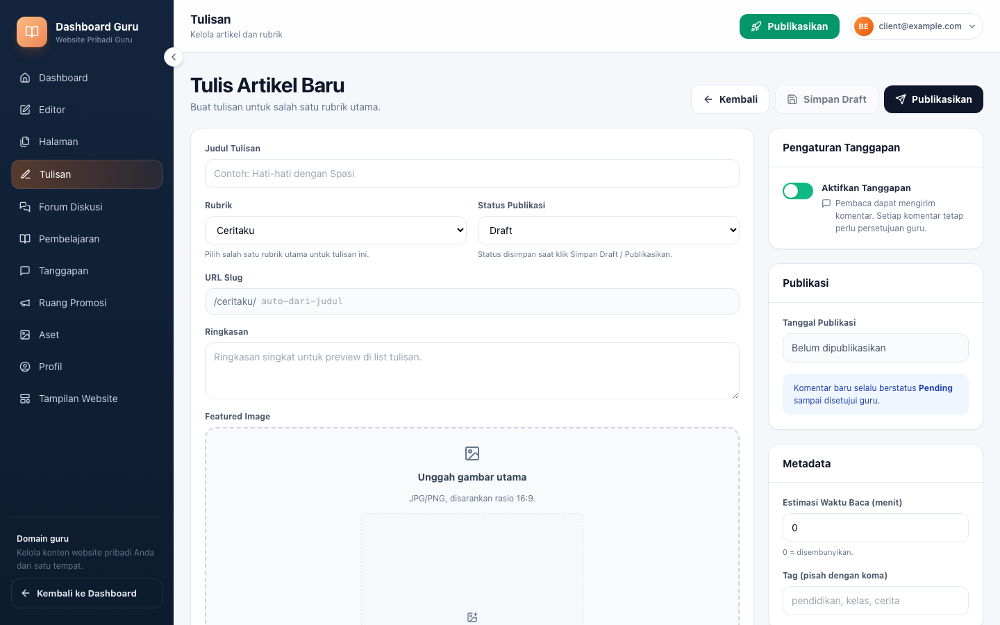

Kelompok toolbar:
1. **Format text** — Bold, Italic, Strikethrough, Inline code
2. **Heading** — H1 / H2 / H3
3. **List** — Bullet, Numbered, Task list (checkbox), Quote, Code block,
   Horizontal rule
4. **Insert** — Link, Gambar (dari asset), Audio (dari asset), YouTube,
   Table
5. **History** — Undo, Redo

Keyboard shortcut standar: `⌘B` bold, `⌘I` italic, `⌘Z` undo, `⌘⇧Z` redo.

### 7.2. Insert Gambar

**Cara 1 — Tombol asset**: klik ikon gambar di toolbar → dialog asset picker
terbuka. Pilih dari library atau upload baru (drop file / klik "Upload").

**Cara 2 — Drag & drop langsung ke editor** (fitur baru): drop file gambar
dari desktop / File Explorer langsung ke body editor. Sistem otomatis
upload ke asset library situs + insert di posisi drop.

**Ganti ukuran**: klik gambar → sub-toolbar **Ukuran** muncul di bawah
toolbar utama dengan 4 preset: S (25%) · M (50%) · L (75%) · Full (100%).

### 7.3. Insert Video YouTube

Klik ikon YouTube di toolbar → dialog. Paste URL YouTube (bentuk apapun
diterima: `youtube.com/watch?v=X`, `youtu.be/X`, `youtube.com/embed/X`,
`youtube.com/shorts/X`).

**Hapus video** (fitur baru): dulu video susah di-delete karena iframe
menelan klik. Sekarang klik overlay area video → node ter-select (border
biru + tombol × di corner). Klik × atau tekan Backspace/Delete untuk hapus.

**Play preview**: kalau node sudah selected, klik iframe kedua kali → mode
play. Klik di luar untuk keluar seleksi.

### 7.4. Insert Audio

Klik ikon Audio di toolbar → dialog asset picker filter kind=audio. Pilih
file audio yang sudah di-upload di menu **Aset**.

**Hapus audio**: sama pattern dengan YouTube — klik overlay untuk select,
klik × untuk hapus.

### 7.5. Insert Tabel

Klik ikon Tabel → menu dropdown (Insert 3x3, Add row, Add column, Delete
row, Delete column, Delete table). Tabel default punya baris header.
Styling di renderer sudah include border + padding + header background —
konsisten di semua halaman detail (blog / rubric / pembelajaran).

### 7.6. Task List (Checkbox)

Klik ikon checklist → list checkbox. Setiap item bisa di-toggle
(centang/uncheck) langsung di editor + di renderer. Bisa nested (indent
child dengan Tab).

### 7.7. Paste dari Word / Google Docs

Copy dari Word, Google Docs, Notion, atau editor lain → paste ke editor.
Sistem otomatis **strip formatting bloat** (font-family Calibri, mso-*
attributes, span kosong) — hanya struktur text + heading + list + link
yang dipertahankan. Aman untuk paste artikel panjang tanpa merusak layout.

### 7.8. Autosave (Fitur Baru)

Semua form tulisan / materi / blog / artikel platform sekarang punya
**autosave otomatis**:

- **Debounce 3 detik** — 3 detik setelah Anda berhenti mengetik, sistem
  auto-save silent (tidak ada notif toast)
- **Guard validasi** — cuma jalan kalau judul + slug sudah terisi (biar
  tidak save half-broken)
- **Preserve status** — tidak auto-publish; kalau status draft, tetap
  draft
- **Cuma di edit mode** — untuk artikel baru, wajib klik Simpan Draft
  pertama kali (agar record ter-create)

Indikator visual di header form:

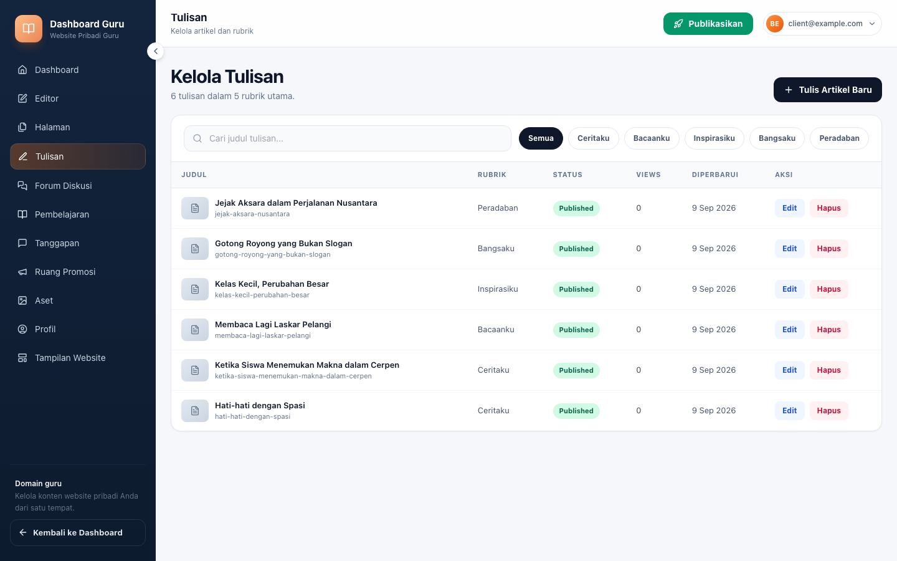

Setelah save (auto atau manual):

Tombol **Simpan Draft** otomatis disabled saat tidak ada perubahan
(tooltip: "Tidak ada perubahan untuk disimpan").

### 7.9. Warning Saat Keluar Tanpa Simpan

Kalau ada perubahan belum tersimpan (badge amber muncul) dan Anda:
- **Tutup tab / refresh browser** → browser native prompt "Perubahan Anda
  mungkin tidak tersimpan"
- **Klik tombol Kembali** → confirm dialog "Ada perubahan belum disimpan.
  Yakin ingin keluar?"

Sengaja dobel-guard supaya draft yang belum disave tidak hilang tanpa
sadar.

---

## 8. Menulis Tulisan Rubrik

Menu **Tulisan** → daftar artikel dengan tabs 6 rubrik (Ceritaku / Bacaanku
/ Inspirasiku / Bangsaku / Peradaban / Forum Diskusi).

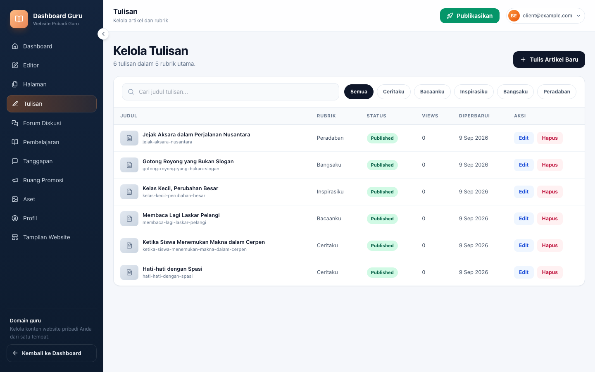

Klik **Tulisan Baru** → form editor. Pilih rubrik → judul → slug (auto
dari judul) → excerpt → isi (Rich Editor) → cover image → tags → status.
Simpan draft / publikasikan.

Rubrik **Forum Diskusi** khusus: comments otomatis enabled (tidak bisa
disabled) — supaya pembaca bisa langsung reply.

---

## 9. Materi Pembelajaran

Menu **Pembelajaran** → daftar materi (mis. modul, RPP, latihan soal).
Beda dengan Tulisan: tidak ada views + tidak ada tanggapan. Fokus konten
ajar untuk siswa/pembaca.

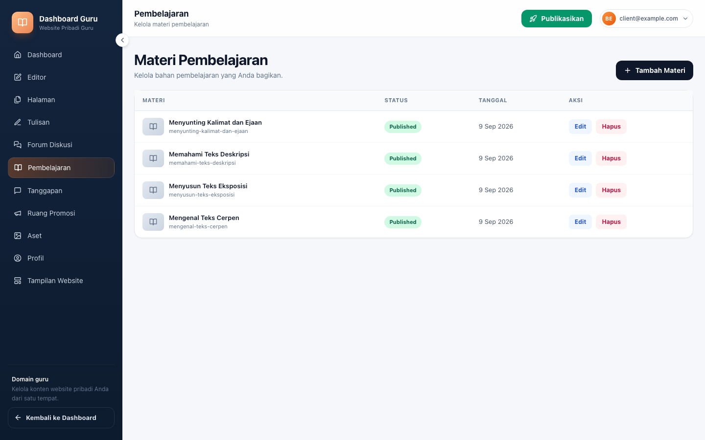

Klik **Materi Baru** → form sama seperti tulisan (judul + slug + excerpt
+ Rich Editor + cover + tags + ringkasan) tapi lebih sederhana.

---

## 10. Ruang Promosi

Menu **Ruang Promosi** → banner 2:1 untuk program pelatihan, komunitas,
event, dll. Muncul di seksi Ruang Promosi di beranda.

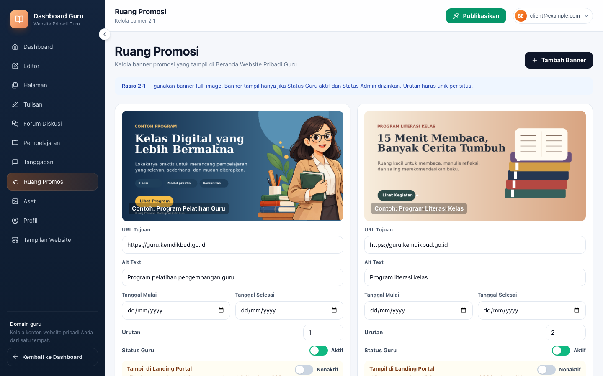

**Portal aktif** — maksimal 1 banner per guru bisa di-toggle "aktif di
landing portal `/guru`" (tampil di direktori publik). Guru lain juga bisa
menampilkan 1 banner mereka → shared landing.

---

## 11. Moderasi Tanggapan

Menu **Tanggapan** → komentar pembaca di tulisan Anda. Tab filter:
Menunggu / Disetujui / Ditolak. Aksi per komentar: **Setujui** / **Tolak**.

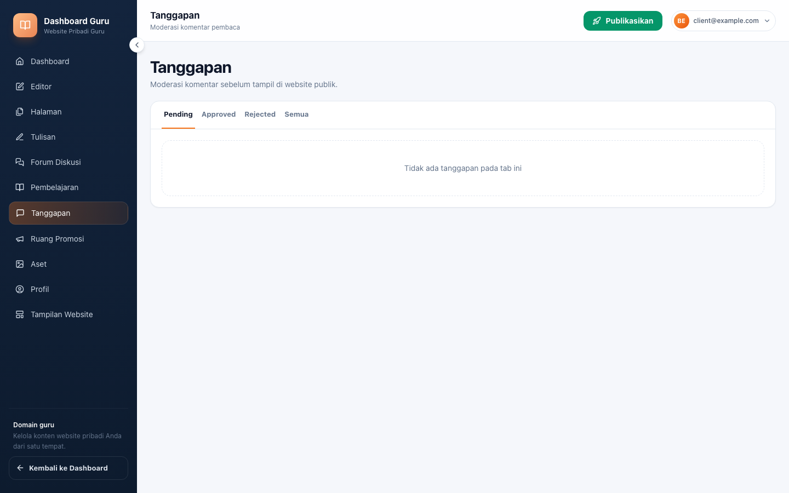

Komentar yang menunggu tidak tampil di publik sampai Anda setujui.

---

## 12. Profil Guru

Menu **Profil** (URL: `/sites/[id]/profil`) → identitas Anda yang tampil
di:
- Kartu di direktori portal `/guru` (publik)
- Halaman **Profil** di situs Anda
- Beberapa blok Guru (Profile Card, Hero, dsb) yang read dari profil

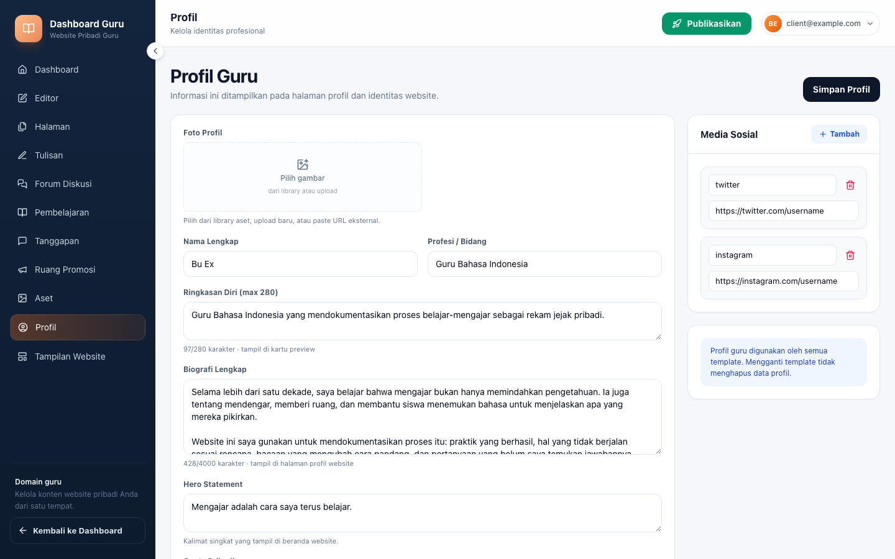

Field wajib untuk tampil di direktori portal:
- **Nama** (dari akun, otomatis)
- **Mata Pelajaran / Bidang**
- **Bio Singkat** (max 280 karakter)

Field opsional:
- Foto profil (URL dari asset)
- Hero statement (1-2 baris di beranda)
- Quote pribadi
- Bio lengkap (max 4000 karakter)
- Tautan sosial (Twitter, Instagram, YouTube, dll — max 10)

---

## 13. Publikasi + Preview

### 13.1. Preview Draft (Tanpa Publish)

Di editor blok, ketuk **Pratinjau** di toolbar → generate link share
sementara (berlaku 1 jam). Link ini bisa Anda kirim ke rekan/tim untuk
review sebelum publish.

### 13.2. Publikasi Halaman

Di editor blok, ketuk **Terbitkan** → salin draft ke versi live.
Perubahan langsung visible di domain publik Anda.

Tombol Terbitkan otomatis disabled kalau tidak ada perubahan sejak
publish terakhir.

### 13.3. Publikasi Situs (Semua Halaman Sekaligus)

Di dashboard situs (URL: `/sites/[id]`), ketuk tombol **Publikasikan** di
header → mengubah status situs ke `published` + memicu cache purge
supaya konten baru langsung visible di CDN.

---

## 14. Ganti Domain / Situs Kedua

**Ganti domain untuk situs existing**: belum didukung. Kalau perlu ganti
domain, hubungi admin.

**Situs kedua** (kalau punya multiple domain): balik ke dashboard klien
(`/dashboard`) → semua situs Anda tampil di grid → klik yang mau dikelola.

---

## 15. Perpanjangan Domain

Domain aktif punya masa berlaku 1 tahun (default). Sistem kirim
notifikasi email ke Anda **30 hari sebelum expire**, di-resend tiap 7 hari
sampai Anda perpanjang.

- Buka **Domain Saya** dari dropdown avatar → daftar domain
- Ketuk domain yang expire soon → tombol **Perpanjang**
- Sama seperti beli: pilih metode bayar → wait → aktif
- Perpanjangan tidak mengubah data situs Anda — cuma memperpanjang masa
  berlaku domain

Kalau domain expired tanpa diperpanjang → situs offline sementara. Guru
punya 30 hari grace period untuk perpanjang sebelum domain benar-benar
lepas ke pihak lain.

---

## 16. FAQ

**Q: Apakah bisa migrasi konten dari platform lain (WordPress, Medium)?**  
A: Untuk sekarang manual copy-paste (Rich Editor otomatis sanitize
bloat). Import bulk belum tersedia.

**Q: Apakah bisa punya lebih dari 1 admin di situs saya?**  
A: Bisa. Buka **Settings → Collaborators** → invite email → assign role
`editor` atau `viewer`. Editor bisa edit semua konten kecuali delete
situs. Viewer hanya lihat.

**Q: Bagaimana kalau saya lupa toggle Layout Bersama Header dan halaman
saya jadi tanpa header?**  
A: Buka Editor → sidebar kiri → seksi **Layout Bersama** → ketuk **Header**
→ toggle **"Header aktif"** ke ON. Header langsung muncul di semua
halaman lagi. Blok tersimpan aman selama toggle OFF, tidak hilang.

**Q: Kenapa video saya susah di-hapus?**  
A: Fitur ini sudah diperbaiki. Klik area video di editor → node
ter-select (border biru + tombol × muncul). Klik × atau tekan
Backspace/Delete.

**Q: Autosave tidak jalan?**  
A: Cek:
1. Sudah edit mode? (autosave tidak jalan di form buat baru — wajib
   klik Simpan Draft dulu sekali)
2. Judul + slug sudah terisi?
3. Ada perubahan (badge amber "Belum disimpan" muncul)?
Kalau semua yes, tunggu 3 detik → badge berubah jadi emerald "Tersimpan".

**Q: Paste dari Word bawa formatting aneh?**  
A: Sudah diperbaiki. Paste sekarang otomatis strip inline styles + Word
artifacts. Struktur (paragraf, heading, list, link) tetap dipertahankan.

**Q: Bisa upload gambar sekaligus banyak?**  
A: Belum di editor Rich, tapi bisa di menu **Aset** — bulk upload via
drop multiple files. Copy URL-nya, insert satu-satu di editor.

---

## Lampiran — Struktur URL Publik

Setelah publish, konten Anda accessible via:

- Beranda: `https://[domain-anda]/`
- Halaman biasa: `https://[domain-anda]/[slug]` (mis. `/about`)
- Rubrik: `https://[domain-anda]/[rubrik]` (mis. `/ceritaku`)
- Tulisan detail: `https://[domain-anda]/[rubrik]/[slug]`
- Materi: `https://[domain-anda]/pembelajaran/[slug]`
- Blog (kalau ada): `https://[domain-anda]/blog/[slug]`

Direktori portal publik (semua guru): `https://bikinweb.pandi.id/guru`
